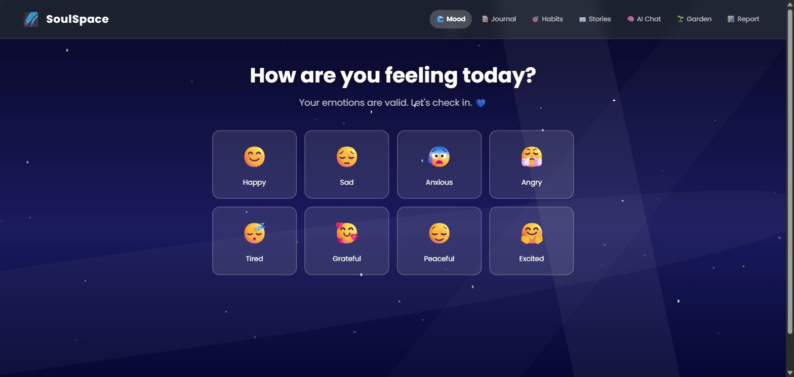

# SoulSpace 🌌

A mental wellness app built as a safe space to check in, reflect, and build healthier habits — one day at a time. SoulSpace pairs mood tracking with journaling, gamified habit-building, an AI-style companion chat, a "growth garden" that visualizes your progress, and weekly wellness reports.

**Live demo:** https://incredible-cendol-277541.netlify.app/



## Features

- **Mood check-ins** — log how you're feeling with a calm, ocean-animated home screen
- **Journal** — a private space to write and reflect
- **Habit battles** — gamified habit tracking that turns consistency into a game
- **Support companion chat** — a guided chat with pre-written supportive replies (not AI, not a therapist). Crisis language is detected first and always answered with real helpline information
- **Get help page** — verified crisis lines, reachable from every screen, signed in or not
- **Growth garden** — a visual representation of your progress that grows as you build habits
- **Weekly reports** — a summary of mood trends and habit progress over time

## Tech stack

- [React](https://react.dev/) (Create React App)
- [React Router](https://reactrouter.com/) for client-side navigation between Mood, Journal, Habits, Stories, AI Chat, Garden, and Report views
- [Supabase](https://supabase.com/) (PostgreSQL + Auth) for accounts and synced data, protected by Row Level Security so each person can only read their own rows
- `localStorage` fallback: "Continue without an account" keeps everything on the device, and earlier entries are copied into your account when you sign up
- Jest + React Testing Library tests for crisis detection, streak logic and the chat safety flow

## Running it locally

```bash
git clone https://github.com/talk2brownn/Soulspace.git
cd Soulspace
npm install
npm start
```

The app will open at `http://localhost:3000`. Without Supabase keys it runs in device-only mode (everything stays in your browser).

### Connecting Supabase (accounts + sync)

1. Create a project at [supabase.com](https://supabase.com/).
2. In **SQL Editor**, paste and run [`supabase/schema.sql`](supabase/schema.sql). It creates the tables and turns on Row Level Security.
3. Copy `.env.example` to `.env` and fill in your project URL and **anon** key (Project Settings → API). Never use the `service_role` key in the app.
4. In **Authentication → URL Configuration**, set the Site URL to your live site (and add `http://localhost:3000` for local testing).
5. Restart `npm start`.

### Tests

```bash
npm test
```

### Deploying to Netlify

`public/_redirects` makes page refreshes on routes like `/journal` work. Add `REACT_APP_SUPABASE_URL` and `REACT_APP_SUPABASE_ANON_KEY` under Site configuration → Environment variables, then redeploy.

## Author

Built by [Emediong "Brown" Ubong Ekwere](https://github.com/talk2brownn) — see more projects on my [portfolio](https://testingreactt.netlify.app/).

---

*SoulSpace is a personal project and not a substitute for professional mental health care. If you're struggling, please reach out to a licensed professional or a crisis line in your area.*
